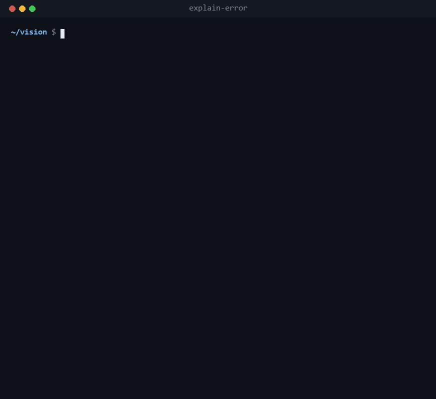

<h1 align="center">explain-error</h1>

<p align="center">
<a href="https://pypi.org/project/xerr/"></a>
<a href="https://github.com/bjornhbengtsson/explain-error/actions/workflows/test.yml"></a>
<a href="https://pypi.org/project/xerr/"></a>
<a href="LICENSE"></a>
</p>

<p align="center"><b>Your error, in plain English. With the fix.</b></p>

<p align="center">
Pipe any stack trace, compiler error or failed command into <code>explain-error</code>.<br>
It tells you what happened, where, and the exact command or change that fixes it.<br>
Offline. Zero dependencies. Optional Claude mode for everything else.
</p>

<p align="center">
<b>105 rules</b> · <b>9 ecosystems</b> · <b>0 dependencies</b> · <b>works offline</b> · <b>agent skill included</b>
</p>

---

<p align="center">
  
</p>

It knows `cv2` is really `opencv-python`, `sklearn` is `scikit-learn`, `PIL` is `pillow`, and so on.

## Install

```bash
pipx install xerr      # or: uv tool install xerr
```

Or try it without installing: `uvx xerr "TypeError: data.map is not a function"`

Needs Python 3.11+. The package is called `xerr` on PyPI; it installs both the `explain-error` and `xerr` commands.

## Use it

```bash
explain-error -- npm run build              # run a command; explain it only if it fails
python app.py 2>&1 | explain-error          # pipe in any output
explain-error "fatal: not a git repository" # paste an error
xerr -- cargo build                         # short alias
```

| Flag | What it does |
|---|---|
| `-- <command>` | Runs the command, shows its output live, and explains it if it fails. Keeps the command's exit code, so it's safe in scripts. |
| `--ai` | Also asks Claude, for errors no rule covers or for a diagnosis specific to your log. |
| `--all` | Shows every rule that matched, not just the best one. |
| `--json` | Prints machine-readable output for editors, CI and agents. |
| `--list` | Lists every built-in rule. |

## Shell mode: type `huh` after anything fails

Add one line to your shell's startup file. After that, any command that fails gets a dim hint, and typing `huh` explains it:

```bash
echo 'eval "$(xerr init bash)"' >> ~/.bashrc                        # bash
echo 'eval "$(xerr init zsh)"' >> ~/.zshrc                          # zsh
echo 'xerr init fish | source' >> ~/.config/fish/config.fish        # fish
```

```powershell
Add-Content $PROFILE 'Invoke-Expression (& xerr init powershell | Out-String)'   # PowerShell
```

Shells don't keep a command's output, so `huh` asks before re-running the failed command to capture its error. Missing commands are explained without re-running anything, and so are PowerShell's own errors. Nothing runs at the prompt except a few lines of shell code; Python starts only when you type `huh`.

| Setting | Effect |
|---|---|
| `xerr init bash --name wtf` | Use another name instead of `huh` |
| `XERR_NO_HINT=1` | Hide the hint after failures |
| `XERR_NO_CONFIRM=1` | Re-run without asking |
| `XERR_AI=1` | Also ask Claude (see `--ai` below) |

## What it covers

| Ecosystem | Examples |
|---|---|
| **Python** | `ModuleNotFoundError` (with pip-name mapping), `NoneType` attribute errors, `KeyError`, indentation, `UnicodeDecodeError`, circular imports, `externally-managed-environment`, the Windows Store `python` alias |
| **JavaScript / Node** | `Cannot read properties of undefined`, `is not a function`, `ERR_REQUIRE_ESM`, `EADDRINUSE`, `ECONNREFUSED`, CORS, `Unexpected token '<'` in JSON, npm `ERESOLVE` |
| **React** | Invalid hook call, objects as children, too many re-renders, hydration mismatches |
| **TypeScript** | TS2307, TS2339, TS2322, TS2345, possibly `undefined`, implicit `any` |
| **git** | Rejected pushes, merge conflicts, password auth removed, `publickey`, no upstream, unrelated histories, files over 100 MB |
| **Rust** | E0382 moved values, E0502 borrows, E0308, E0425, E0599, lifetimes, `unwrap()` panics |
| **Go** | Unused imports and variables, nil pointers, deadlocks, nil maps, missing modules |
| **Java** | Helpful NPEs, class not found, class file version mismatch, `cannot find symbol` |
| **C / C++** | Segfaults, `undefined reference`, missing headers, implicit declarations, double free |
| **Shell / Docker** | Command not found (bash, zsh, PowerShell, cmd), PowerShell execution policy, permission denied, Docker daemon down, port already allocated |

It also finds **where** the error happened. It reads Python tracebacks, Node and Java stack traces, Rust and Go output, and gcc/clang/tsc locations, and skips library frames so you land in your own code.

## For AI coding agents

explain-error ships as an [agent skill](skills/explain-error/SKILL.md). It lets Claude Code, Codex, Cursor and other agents use the same curated rules, so they check their diagnosis against them instead of guessing, and explain failures to you in three lines instead of thirty.

```bash
npx skills add bjornhbengtsson/explain-error
```

## `--ai` mode

Rules cover the common errors. For everything else, `--ai` sends the log to Claude and gets back a short diagnosis specific to your error. Any rule that matched is passed along as a hint.

```bash
pipx install "xerr[ai]"
export ANTHROPIC_API_KEY=...        # or: ant auth login
explain-error --ai -- pytest
```

It uses `claude-opus-5-5` by default. Change that with `--model` or `EXPLAIN_ERROR_MODEL`.

> **Privacy:** without `--ai`, nothing leaves your machine. With `--ai`, the error text is sent to the Anthropic API, so check logs for secrets first.

## Add a rule (it takes 5 minutes)

Every rule is about 15 lines of TOML in [`src/explain_error/rules/`](src/explain_error/rules), and every rule carries its own test case:

```toml
[[rule]]
id = "py-name-error"
pattern = '''NameError: name '(?P<name>\w+)' is not defined'''
title = "`{name}` is used before it exists"
explain = "Python reached a line that uses `{name}`, but nothing by that name is defined yet."
fixes = ["Check for a typo", "If `{name}` comes from a library, import it at the top of the file"]
examples = ["NameError: name 'pd' is not defined"]
```

Got an error that explain-error didn't recognize? [Open an issue](https://github.com/bjornhbengtsson/explain-error/issues/new) and paste it in, or read [CONTRIBUTING.md](CONTRIBUTING.md) and send a rule.

## License

MIT
